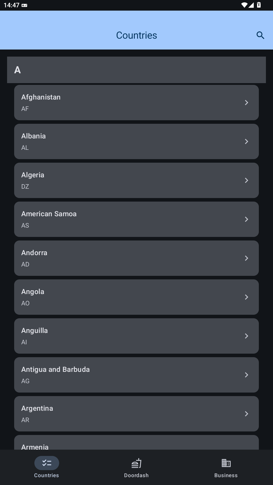
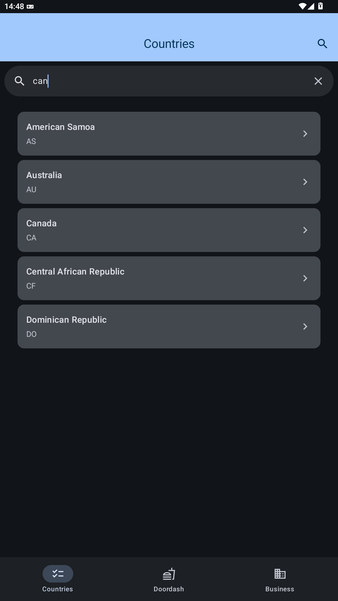
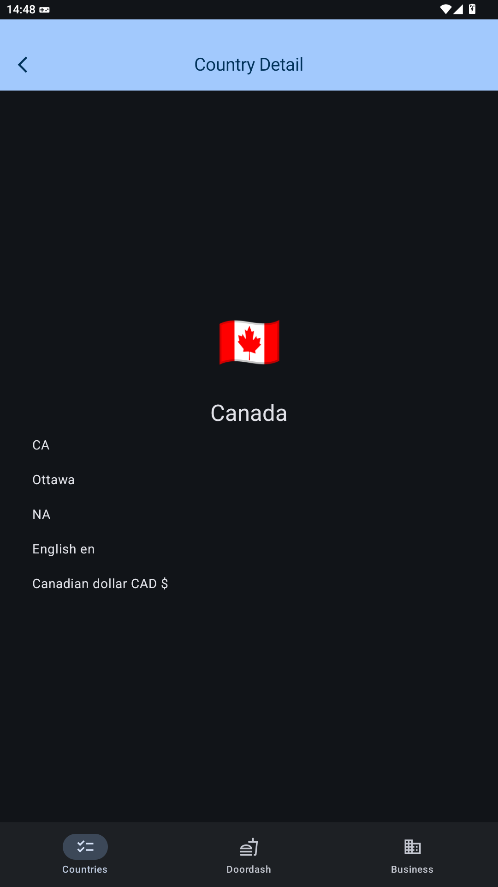
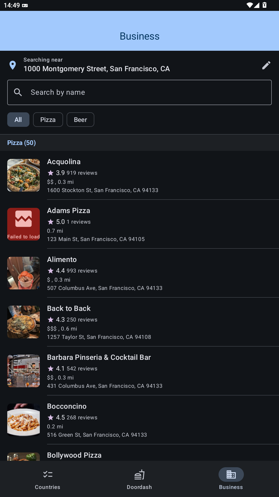
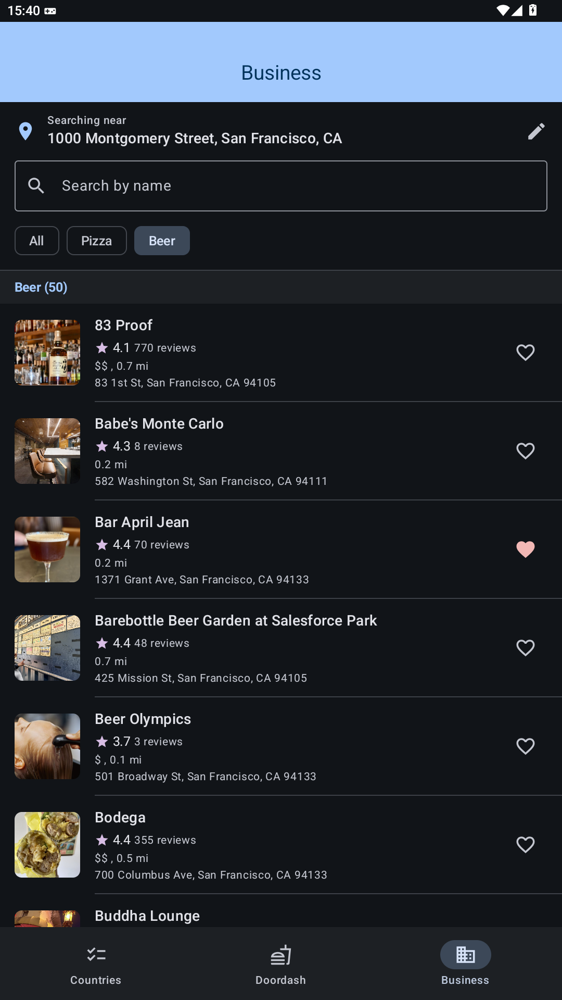
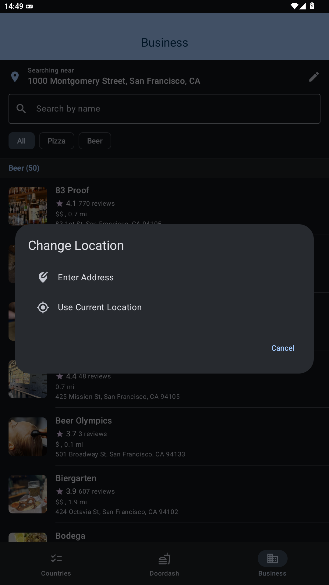
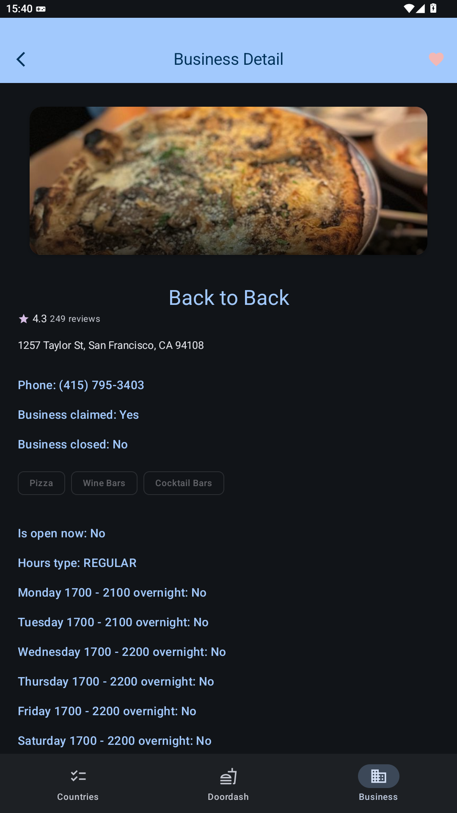
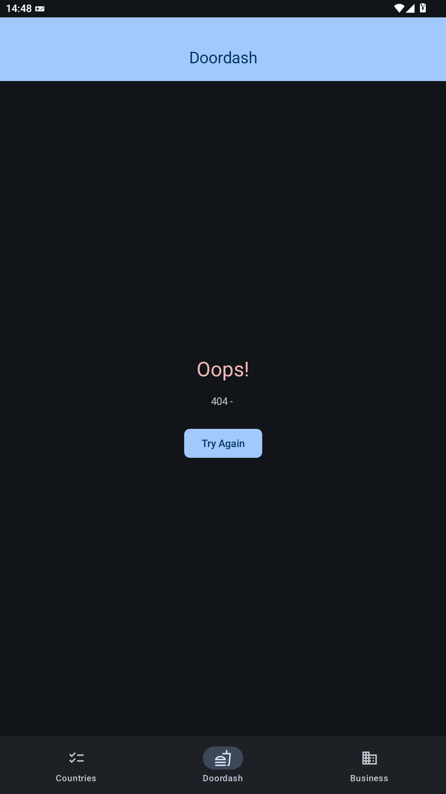

# My Application

A native Android app built with Jetpack Compose, showcasing a multi-module architecture with three independent features: a **Country browser**, a **DoorDash-style restaurant list**, and a **Yelp-backed "Pizza & Beer" business search** with device-location support and likes. It's structured as a playground for modern Android patterns — Navigation 3, Hilt, Room, Retrofit/Flow, Play Services location, and a layered set of shared core modules.

## Screenshots

Captured from the debug build on an Android 15 emulator (1080×1920, dark theme) using live API data.

### Countries

| Country list | Search | Country detail |
| :---: | :---: | :---: |
|  |  |  |
| A–Z sections; tap the search icon to filter | Matches name, code or capital (debounced) | Flag emoji, code, capital, region, language, currency |

### Business (Yelp "Pizza & Beer")

| Pizza & beer list | Beer filter | Change location | Business detail |
| :---: | :---: | :---: | :---: |
|  |  |  |  |
| Sections by category, search by name, All/Pizza/Beer chips, heart to like | Category filter; likes are kept across filters | Type an address or use device location | Like from the top bar; the list shows the same status when you go back |

### DoorDash

| Restaurant list |
| :---: |
|  |
| The configured `DOORDASH_SERVER_ENDPOINT` currently returns **HTTP 404**, so this shows the shared error view with **Try Again**. The list and detail screens render once the endpoint responds. |

To refresh these, install the debug build (`./gradlew :app:installDebug`), open each page, and capture it with `adb exec-out screencap -p > docs/screenshots/<name>.png`. Lock the emulator to portrait first (`adb shell settings put system accelerometer_rotation 0` and `adb shell settings put system user_rotation 0`) so the images match.

## Modules

```
MyApplication/
├── build-logic/             # Included build with the Gradle convention plugins and module dependency rules
├── app/                     # Application shell: DI wiring, Room DB, top-level navigation, theme
├── core/
│   ├── domain/              # Pure contracts: Result/EmptyResult, DataError/Kind, UseCaseOutputWithStatus, LocationAddressProvider
│   ├── network/             # Retrofit FlowErrorHandlingCallAdapterFactory + typed RetrofitException
│   ├── presentation/        # Compose components, UIState, error mapping, location permission requester, Navigation 3 plumbing
│   ├── shared-lib/          # FlowUseCase, ObserveAsEvents, location permission helpers, utilities
│   └── location/            # FusedLocationAddressProvider (Play Services + Geocoder) and its Hilt LocationModule
└── features/
    ├── feature-country/     # Browse countries fetched from a REST API, search, and view details
    ├── feature-doordash/    # Browse nearby restaurants, like/unlike them (persisted locally)
    └── feature-business/    # Search nearby pizza & beer spots on Yelp, filter/search, like, view details
```

### Dependency rules

- **`app`** depends on `core:location`, `core:presentation`, and all three features. It owns the `MyAppDatabase` (Room), app-wide Hilt modules (`AppModule`/`AppQualifiers`: dispatchers, `SharedPreferences`, DB/DAO providers), and the bottom-nav host (`AppFeatureNavigation`) that stitches the Country, DoorDash, and Business nav graphs together (start route: `CountryRoute.Countries`).
- **Features** each depend on `core:domain`, `core:presentation`, `core:network`, and `core:shared-lib`. Features never depend on each other; they are wired into the app only through navigation entry points.
- **`core:location`** depends on `core:domain` and `core:shared-lib`.
- **`core:network`**, **`core:presentation`**, and **`core:shared-lib`** expose `core:domain` via `api`. `core:domain` depends on nothing.

These rules are **enforced by the build**, so the module graph can't form a cycle. The `myapp.module.rules` plugin (applied by every module through its convention plugin) checks each `project(...)` dependency as it is declared and fails at configuration time with the reason, e.g.:

```
Module dependency rule broken: :feature-business -> :feature-country (in 'implementation'):
feature modules must not depend on each other (:feature-country); move shared code to a :core module
```

| From | May depend on |
| --- | --- |
| `:app` | anything |
| `:feature-*` | `:core:*` only, never another feature |
| `:core:*` | core modules in a **lower** layer only |
| anything | never `:app` |

Core layers (defined in `build-logic/.../ModuleRules.kt`):

| Layer | Modules |
| --- | --- |
| 0 | `core:domain` |
| 1 | `core:network`, `core:shared-lib` |
| 2 | `core:presentation`, `core:location` |

Every core edge points to a strictly lower layer, so two core modules can never depend on each other, directly or through others. A new core module must be added to `ModuleRules.coreLayers` with its layer; the build tells you if it's missing.

### Gradle setup

Module build files only declare what is specific to them. Everything shared lives in convention plugins in `build-logic` (an included build, registered with `includeBuild("build-logic")` in `settings.gradle.kts`). All versions come from `gradle/libs.versions.toml`, including the convention plugin ids.

| Plugin | Applies | Used by |
| --- | --- | --- |
| `myapp.android.application` | AGP application + Kotlin, compileSdk/targetSdk 36, minSdk 24, Java/JVM 17, release build type, module rules | `app` |
| `myapp.android.library` | AGP library + Kotlin, the same SDK/JVM settings, consumer ProGuard rules, module rules | every `core` module |
| `myapp.android.compose` | Compose compiler, `buildFeatures.compose`, Compose BOM for main/test/androidTest, `ui-test-manifest`, Android resources in unit tests | `app`, `core:presentation`, `core:shared-lib` |
| `myapp.android.hilt` | Hilt + KSP with `hilt-android`/`hilt-compiler` | `app`, `core:network`, `core:shared-lib`, `core:location` |
| `myapp.android.room` | KSP with Room runtime/ktx/compiler | `app`, `feature-doordash` |
| `myapp.android.feature` | library + compose + hilt, kotlinx.serialization, the secrets plugin with `BuildConfig`, the core modules, and the common feature and test libraries | every `feature-*` module |
| `myapp.module.rules` | The dependency rules above | applied by the application and library plugins |

Shared settings applied to every module:
- `testInstrumentationRunner`, `unitTests.isReturnDefaultValues = true`, and the `junit`, `androidx-junit`, and `espresso-core` test dependencies.
- The Kotlin compiler flag `-Xannotation-default-target=param-property`: an annotation on a constructor `val` (e.g. `@StringRes`) applies to both the parameter and the property.

`gradle.properties` turns on parallel builds, the build cache, and the configuration cache, and gives the Gradle daemon a 4 GB heap (KSP and dex merging run in parallel).

The rules have unit tests: `./gradlew :build-logic:convention:test`.

### Core modules

- **`core:domain`** — framework-free contracts:
  - Typed `Result<T, E : Error>` (`Success` / `Error`) and `EmptyResult<E>`
  - `DataError` with a `Kind` (`NETWORK` / `CONVERSION` / `HTTP` / `UNEXPECTED`)
  - `UseCaseOutputWithStatus` (`Progress → Success/Failed`)
  - `LocationAddressProvider` interface
- **`core:network`** — a Retrofit `CallAdapterFactory` (`FlowErrorHandlingCallAdapterFactory`) that maps network calls into `Flow` + typed `RetrofitException`.
- **`core:presentation`** — Compose building blocks (`SearchBarView`, `ErrorView`, `LoadingViews`, `ListItemViews`, `ImageLoader`, `BottomNavigationBar`, `AppTopBar`, `UIStatefulContent`, etc.), the `UIState<T>` sealed type (`Loading` / `Success` / `Error` / `Default`), error-to-UI mapping, `rememberLocationPermissionRequester`, and Navigation 3 plumbing (`Navigator`, `NavigationState`, polymorphic route serialization).
- **`core:shared-lib`** — `FlowUseCase` (turns a suspend/Flow data call into a `UseCaseOutputWithStatus` stream), `ObserveAsEvents` for one-off UI events, location permission/enabled helpers, and general utilities.
- **`core:location`** — `FusedLocationAddressProvider`, an implementation of `LocationAddressProvider` that gets the current location from the Fused Location Provider and turns it into an address with `Geocoder`, provided through Hilt's `LocationModule`.

## Features

### Country
- Fetches a list of countries from a REST endpoint (`CountryApis`) via `GetCountriesUseCase`.
- Renders an alphabetically-sectioned list (`CountryItem.Letter` / `CountryItem.CountryInfo`) with a live search bar that filters by name, code, or capital.
- Tapping a country opens a detail screen.
- List state survives process death via `SavedStateHandle`.

### DoorDash (restaurants)
- Fetches nearby restaurants by lat/lng (`GetNearByRestaurantsUseCase`) and cross-references each one against a local Room table (`LikedDb`/`LikedDao`) to show its liked/unliked status.
- Users can like/unlike a restaurant; the state is persisted locally and merged back into the list on next load.
- A detail screen (`GetRestaurantDetailUseCase`) shows more info per restaurant.

### Business (Yelp "Pizza & Beer")
- `SearchPizzaAndBeerUseCase` runs the Yelp `businesses/search` query for pizza and for beer at the same time and combines the results. If only one search fails, the other is still shown and the failed category is reported in `failedCategories`. The use case fails only if both searches fail.
- `BuildBusinessSectionsUseCase` groups the results into sections by category, filtered by `BusinessFilter` (All / Pizza / Beer) and the search query. It removes duplicates and sorts each section by name.
- The address header lets the user use the device's current location (`GetCurrentAddressUseCase` → `LocationAddressProvider`) or type an address in `AddressDialog`. The default address is `1000 Montgomery Street, San Francisco, CA`.
- Supports pull-to-refresh and retry. Tapping a business opens a detail screen (`GetBusinessDetailUseCase`, Yelp `businesses/{id}`).
- The list screen follows a state/action/event (MVI-style) contract: `BusinessListState`, `BusinessListAction`, `BusinessListEvent` consumed via `ObserveAsEvents`.

#### Likes
Users can like or unlike a business from the list (heart on each row) or from the detail screen (heart in the top bar). Both screens always show the same status, including after going back from the detail screen, and likes are kept across app restarts.

- **One source of truth.** `BusinessLikedStore` (`@Singleton`) holds the liked ids in a `StateFlow<Set<String>>` and saves them to `SharedPreferences`.
- **ViewModels only talk to use cases.** Neither ViewModel touches the store; three use cases do:

  | Use case | What it does |
  | --- | --- |
  | `ToggleBusinessLikeUseCase` | Toggles one business, emits the new liked state once, then completes. |
  | `ObserveLikedBusinessIdsUseCase` | Long-lived stream of the liked ids: the current set, then every change from any screen. |
  | `GetBusinessDetailUseCase` | Fetches the detail once and combines it with that business's liked status, so a toggle re-emits the detail with the new `isLiked` without another network call. |

- **List.** `BusinessesViewModel` combines the search results, filter, debounced query and `ObserveLikedBusinessIdsUseCase` into `BuildBusinessSectionsInput`. `BuildBusinessSectionsUseCase` is a pure function that marks each `BusinessUi` as `LIKED`/`UNLIKED` from `likedBusinessIds`. A like click only calls `ToggleBusinessLikeUseCase` (failures show a snackbar); the new status arrives through the observed stream.
- **Detail.** `BusinessDetailViewModel` keeps one `GetBusinessDetailUseCase` collection running. A like click only calls `ToggleBusinessLikeUseCase`, and the running collection emits the updated detail.
- **Why going back works.** The list ViewModel stays alive while the detail screen is open, and its sections flow is subscribed to the same store. A toggle on the detail screen rebuilds the list's sections straight away, so the list is already correct when the user goes back.
- **Accessibility.** `LikeToggleButton` is an `IconToggleButton` with the content description "Like"; its on/off state tells TalkBack whether the business is liked.

## Architecture

- **Pattern**: Country and DoorDash use MVVM: Composable screens observe `StateFlow<UIState<T>>` from Hilt `ViewModel`s, user actions call ViewModel functions, and use cases talk to repositories. Business uses an MVI-style state/action/event contract on the same foundations.
- **DI**: [Hilt](https://dagger.dev/hilt/), with a module per feature (`CountryModule`, `DoordashModule`, `BusinessModule`), `LocationModule` in `core:location`, and app-level providers in `AppModule`.
- **Navigation**: [Navigation 3](https://developer.android.com/guide/navigation/navigation-3) with type-safe, `@Serializable` route keys and a custom `Navigator`/`NavigationState` layer in `core:presentation` for a shared bottom-nav + top-app-bar shell.
- **Networking**: Retrofit + OkHttp + Gson, with a custom call adapter (`FlowErrorHandlingCallAdapterFactory`) so repositories return `Flow<T>` and errors surface as typed `RetrofitException`s. The Business feature adds an `AuthInterceptor` that sends the Yelp API key as a `Bearer` token.
- **Errors**: typed `Result<T, E : Error>` / `DataError` in `core:domain` for non-network failures such as location lookup. To fail a `flow {}` with a domain error, throw `ErrorExcept(error)`; `FlowUseCase` unwraps it so the `Failed` output carries the original `Error`. Exceptions that already implement `Error` (e.g. `RetrofitException`) pass through unchanged.
- **Location**: Play Services Fused Location Provider + `Geocoder` (`core:location`). Runtime permission is requested with `rememberLocationPermissionRequester` (`core:presentation`).
- **Persistence**: Room (`MyAppDatabase` in `app`, feature-owned DAOs like `LikedDao`) for local state such as liked restaurants. Liked businesses are a small id set, kept in `SharedPreferences` (provided by `PreferenceModule` in `core:shared-lib`) through `BusinessLikedStore`.
- **Async**: Kotlin Coroutines/Flow throughout; `FlowUseCase` standardizes the loading/success/error lifecycle for every use case.
- **UI**: Jetpack Compose + Material 3, `kotlinx.collections.immutable` for stable list state, Coil for image loading.

## Configuration

API base URLs and API keys are injected as `BuildConfig` fields via the [Secrets Gradle Plugin](https://github.com/google/secrets-gradle-plugin):

| Key | Used by |
| --- | --- |
| `COUNTRY_SERVER_ENDPOINT` | `feature-country` |
| `DOORDASH_SERVER_ENDPOINT` | `feature-doordash` |
| `YELP_SERVER_ENDPOINT` | `feature-business` |
| `YELP_API_TOKEN` | `feature-business` (`AuthInterceptor`) |

Define them in a local, git-ignored `secrets.properties` (or `local.properties`) at the project root:

```properties
COUNTRY_SERVER_ENDPOINT=https://your-country-api.example.com/
DOORDASH_SERVER_ENDPOINT=https://your-doordash-api.example.com/
YELP_SERVER_ENDPOINT=https://api.yelp.com/v3/
YELP_API_TOKEN=your-yelp-fusion-api-key
```

`YELP_API_TOKEN` is a real credential - never hardcode it in source, only in the git-ignored properties file.

### Permissions

The app declares `INTERNET`, `ACCESS_NETWORK_STATE`, `ACCESS_COARSE_LOCATION`, and `ACCESS_FINE_LOCATION`. Location is requested at runtime only when the user chooses "use my location" in the Business feature; if it is denied, a message is shown and the user can still type an address instead.

## Tech stack

| Area | Library | Version |
| --- | --- | --- |
| Language | Kotlin | 2.2.0 |
| Build | Android Gradle Plugin | 8.13.2 |
| UI | Jetpack Compose (BOM) + Material 3 | 2025.12.01 |
| Navigation | Navigation 3 | 1.0.0 |
| DI | Hilt | 2.57.2 |
| Persistence | Room | 2.7.2 |
| Networking | Retrofit / OkHttp | 3.0.0 / 4.12.0 |
| Images | Coil | 3.4.0 |
| Async | Kotlin Coroutines (+ Play Services) | 1.11.0 |
| Location | Play Services Location | 21.4.0 |
| Serialization | Kotlinx Serialization | 1.9.0 |
| Testing | JUnit 4, kotlinx-coroutines-test, Turbine | 4.13.2 / 1.11.0 / 1.2.0 |
| UI testing | Robolectric, Compose UI Test, Espresso | 4.16 / BOM / 3.7.0 |

## Requirements

- Android Studio (AGP 8.13.2)
- JDK 17
- minSdk 24, targetSdk/compileSdk 36

## Build & run

```
./gradlew :app:assembleDebug
```

Or open the project in Android Studio and run the `app` configuration.

## Testing

There are three kinds of tests:

| Kind | Where | Runs on | Command |
| --- | --- | --- | --- |
| Unit tests | `<module>/src/test` | JVM | `./gradlew testDebugUnitTest` |
| Build logic tests (module dependency rules) | `build-logic/convention/src/test` | JVM | `./gradlew :build-logic:convention:test` |
| UI tests (Compose + Robolectric) | `<module>/src/test` (`*UiTest.kt`) | JVM, no device | `./gradlew testDebugUnitTest` |
| Component instrumented tests (Compose) | `features/feature-business/src/androidTest` | Emulator or device | `./gradlew :feature-business:connectedDebugAndroidTest` |
| End-to-end instrumented tests (Compose + Espresso) | `app/src/androidTest` | Emulator or device | `./gradlew :app:connectedDebugAndroidTest` |

Run a single module with e.g. `./gradlew :feature-business:testDebugUnitTest`. Reports are written to `<module>/build/reports/tests/testDebugUnitTest/index.html` (JVM) and `app/build/reports/androidTests/connected/debug/index.html` (instrumented).

`connectedDebugAndroidTest` runs on **every** attached device. To use just one, set `ANDROID_SERIAL` (e.g. `ANDROID_SERIAL=emulator-5556 ./gradlew :feature-business:connectedDebugAndroidTest :app:connectedDebugAndroidTest`). Installing needs some free space on the device: an emulator with an almost-full `/data` fails with `install-create ... Unknown failure`.

### Unit test approach

- **No mocking library.** Tests use small hand-written fakes at the module boundary: fake Retrofit API interfaces (`FakeBusinessApi`, `FakeCountryApis`, `FakeDoorDashAPIs`), an in-memory `FakeLikedDao`, `FakeBusinessRepository`, `FakeLocationAddressProvider`, and an in-memory `FakeSharedPreferences` (with a `fakeBusinessLikedStore()` helper) so the real `BusinessLikedStore` runs in plain JVM tests. Real repositories, use cases and ViewModels run on top of them.
- **Likes across screens.** Business tests build the list and detail ViewModels (or their use cases) on one shared `BusinessLikedStore`, the way the app's singleton links them. Toggling from one side and checking the other covers the list ↔ detail sync without navigation.
- **Coroutines.** Each feature module has a `MainDispatcherRule` (in its `TestFixtures.kt`) that swaps `Dispatchers.Main` for an `UnconfinedTestDispatcher`. `runTest` shares its scheduler, so debounced search can be tested with `advanceTimeBy`.
- **ViewModels.** `uiState` uses `stateIn(WhileSubscribed)`, so tests keep a collector running in `backgroundScope`. One-off events/channels are checked with Turbine. Where production code hops to `Dispatchers.IO` (Country and DoorDash repositories/ViewModels), tests wait with `uiState.first { … }` instead of reading `value`.
- **Android stubs.** The library and application convention plugins set `testOptions.unitTests.isReturnDefaultValues = true`, so `android.util.Log` calls are no-ops on the JVM.

### UI test approach

- **Robolectric + Compose UI Test.** Screen and component tests use `createComposeRule()` with `@RunWith(AndroidJUnit4::class)`, so they run on the JVM inside `testDebugUnitTest` and need no emulator. They run against SDK 35 (`src/test/resources/robolectric.properties`). The `myapp.android.compose` convention plugin sets `unitTests.isIncludeAndroidResources = true` so real string resources resolve, and adds `ui-test-manifest` as a `debugImplementation` so the test activity is in the manifest.
- **Stateless screens are tested directly.** `BusinessListScreen` and `AddressDialog` get a `BusinessListState` and record the `BusinessListAction`s they send. Screens that take a ViewModel (`CountriesScreen`, `RestaurantScreen`, `BusinessDetailScreen`) get the real ViewModel built on the same fakes as the unit tests. Where the ViewModel hops to `Dispatchers.IO`, tests wait with `composeRule.waitUntil { … }`.
- **Test tags.** The business screens use named tags from `BusinessTestTags` (address header, search field, filter chips, section headers, list, dialogs, `businessItem(id)` rows, `likeButton(id)` on each row, and `DETAIL_LIKE_BUTTON`). Like buttons are checked with `assertIsOn()`/`assertIsOff()`. The list is lazy, so tests scroll a row into view with `performScrollToNode` before checking its like button. Other screens are found by visible text and content descriptions.
- **Component tests on a device.** `BusinessLikeInstrumentedTest` (`feature-business/src/androidTest`) renders `LikeToggleButton` and `BusinessList` on a real device with `createComposeRule()`. It needs no network or Hilt: like clicks flip a local set of liked ids, the same way the ViewModel rebuilds sections.
- **End-to-end on a device.** `MainActivityNavigationTest` launches the real `MainActivity` (real Hilt graph and backends) with `createAndroidComposeRule`. It drives the bottom navigation and uses `Espresso.pressBack()` for the system back button. It checks navigation only, never list data, so it doesn't depend on what the APIs return. Bottom-nav tabs are matched by label (`hasText(title) and isSelectable()`), because Material 3 clears the icon's content description when a label is shown.
- **End-to-end likes.** `BusinessLikeSyncTest` runs the real app against the live Yelp API. It uses whichever business is listed first and its current like status (likes persist between runs): it toggles the like on the detail screen, presses back and checks the list, toggles again on the list and checks the detail, which also restores the original status. It is skipped with `assumeTrue` if the list can't load (no network or API key).

### Coverage

| Module | What's tested |
| --- | --- |
| `core:shared-lib` | `FlowUseCase` (progress/success, input validation, error wrapping, `ErrorExcept` unwrapping, `errorResult` fallback), `Utils` |
| `core:network` | `FlowErrorHandlingCallAdapterFactory` (body and `Response` adapters; HTTP, network, empty-body and unexpected failures, using a fake `Call`), `RetrofitException` |
| `core:presentation` | `Error.toUiError()` mapping, `Navigator`/`NavigationState` (tab switching, detail push/pop, back to start, per-tab stacks, `resetAtFront`, `stacksInUse` order). **UI:** `ErrorView` retry, `UIStatefulContent` slots, `SearchBar` typing/clear, `AppTopBar` back button, `AppNavigationBar` (only `selectedKey` highlighted, highlight follows key changes, clicks report key) |
| `feature-business` | `BusinessRepositoryImp` DTO mapping, `SearchPizzaAndBeerUseCase` (partial and total failure), `BuildBusinessSectionsUseCase`, `GetCurrentAddressUseCase`, `GetBusinessDetailUseCase`, UI mappers, `BusinessesViewModel` (loading, filter, debounced search, address dialog, location permission, location errors shown as localized messages, refresh/retry, saved state, resubscribing doesn't reload, like click, like toggled on another screen updates the list, saved likes shown on first load), `BusinessDetailViewModel` (load, error, retry, like toggles without refetching). **Likes:** `BusinessLikedStore` (toggle result, per-id toggling, saved and restored through preferences, clear, observers get every change), `ToggleBusinessLikeUseCase` (emits once and completes), `ObserveLikedBusinessIdsUseCase` (current ids then every change, shared across use case instances), `GetBusinessDetailUseCase` (re-emits on like change without refetching, ignores other ids), `BuildBusinessSectionsUseCase` (liked ids mark businesses). **UI:** `BusinessesScreen` (real ViewModel: partial-failure snackbar shows the resource text, screen modifier applied only to the root, like button toggles, like from another screen shown in the list), `BusinessListScreen` (loading/error/success, sections, selection, filter chips, search, address header, source dialog, like buttons reflect status, like click sends the action without opening the detail, like follows state changes), `AddressDialog` (prefill, confirm, blank disables search, cancel), `BusinessDetailScreen` (detail, Yes/No and day-name rows, hours, special hours, back, error + retry, like toggles on every tap, saved like shown) |
| `feature-business` (instrumented) | `BusinessLikeInstrumentedTest`: `LikeToggleButton` is clickable, described as "Like" and toggles on/off; list like toggles only that business, doesn't open the detail, works for rows further down, shows likes changed elsewhere; tapping a row opens the detail |
| `feature-country` | `GetCountriesUseCase` grouping, `SearchCountriesUseCase`, flag emoji mapper, `CountriesViewModel` (load, error, restore, search, clear, toggle, selection), `CountryDetailViewModel`. **UI:** `CountriesScreen` (letter headers, search toggle and filtering, selection, error + retry) |
| `feature-doordash` | `LikeStatusTypeConverter`, `DoordashDbRepository`, nearby/detail/like use cases (like emits the new status, overlapping detail requests don't mix up liked statuses), `RestaurantListsViewModel` (starts in `Loading`, load, error, liking updates only that row, emission order), `RestaurantDetailViewModel` (load, restore from saved state, error + retry, emission order). **UI:** `RestaurantScreen` (list, selection, error + retry, like button toggles on every tap), `RestaurantDetailScreen` (load, restore without refetch, error + retry) |
| `app` (instrumented) | `MainActivityNavigationTest`: app launches on Countries with all three tabs, bottom nav switches screens, system back returns to Countries, the highlighted tab follows the current screen. `BusinessLikeSyncTest`: a like toggled on the detail screen is shown in the list after going back, and a like toggled on the list is shown in the detail |

`core:domain` and `core:location` contain only the template example tests. `FusedLocationAddressProvider` and the Room database (`MyAppDatabase`) are not tested yet. They would need instrumented tests or Robolectric with real Play Services and SQLite.
